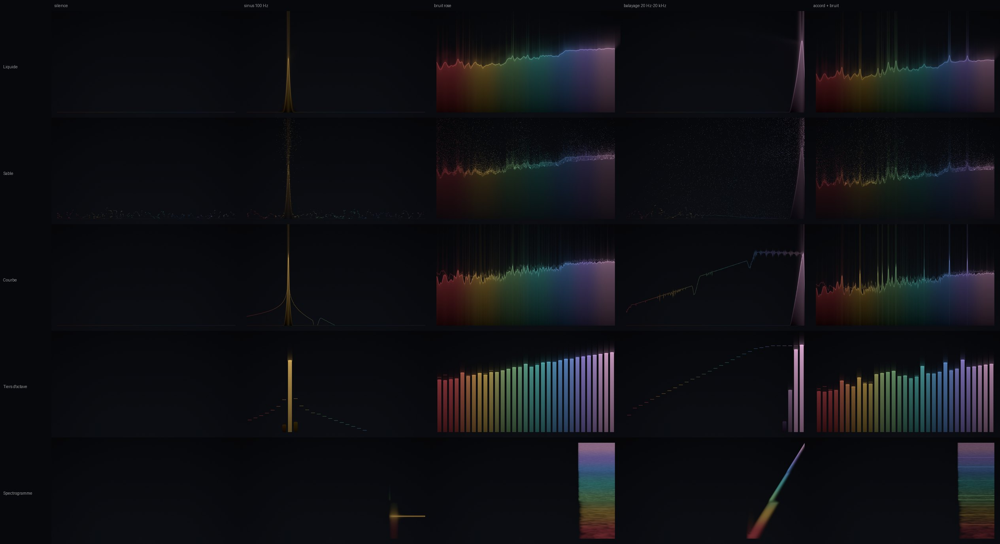
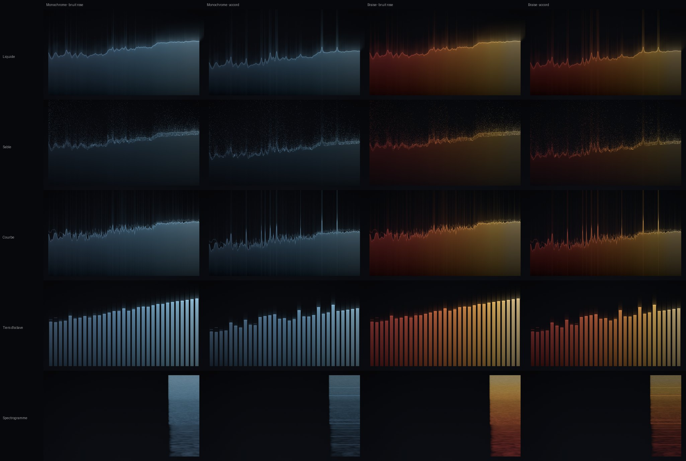

# Spectre

Analyseur de spectre temps réel pour **le son de Spotify uniquement**, en « liquide sombre ». Il fonctionne en fenêtre ou en fond d'écran.

## Installer (5 lignes)
1. Téléchargez `Spectre.zip` depuis la release **latest** : <https://github.com/Elliot-3686/spectre/releases/tag/latest>
2. Décompressez-le et glissez `Spectre.app` dans **Applications**.
3. Dans le Terminal, lancez `xattr -dr com.apple.quarantine /Applications/Spectre.app` (l'app n'est pas notariée).
4. Ouvrez Spectre, puis acceptez **« Autoriser l'accès à l'audio »**. En cas de refus : Réglages Système › Confidentialité et sécurité › Enregistrement de l'écran et de l'audio système › Spectre.
5. Lancez un morceau dans Spotify. Le fond d'écran s'active depuis l'icône 〰︎ de la barre des menus.

## Captures

Captures pleine résolution : branche [`ci-results`](https://github.com/Elliot-3686/spectre/tree/ci-results/snapshots).

## Utilisation
- **Barre des menus** : ouvrir la fenêtre, fond d'écran on/off, écran, visuel, thème, mode démo, réglages, diagnostic.
- **Visuels** : Liquide (par défaut), Sable, Courbe, Tiers d'octave (31 bandes ISO), Spectrogramme.
- **Thèmes** : Sobre, Monochrome, Braise.
- **Survol à la souris** : fréquence, note et niveau exacts sous le curseur (valeurs FFT brutes).
- **Diagnostic…** : mesure la précision et la consommation réelle sur votre Mac pendant 10 s, puis copie le rapport dans le presse-papiers.
- **Mode démo** : pour voir l'app sans Spotify (signal de synthèse).

## Développement
- `Packages/SpectreCore` : DSP (FFT multi-résolution, pics, notes, OKLab), avec ses tests (`swift test`).
- `App/` : AudioCapture, Analysis, Renderer (Metal), Wallpaper, Settings, UI, Tools.
- Projet Xcode généré par XcodeGen : `brew install xcodegen && xcodegen generate && open Spectre.xcodeproj`.
- La CI (GitHub Actions, macOS) compile, teste, produit les captures et les mesures sur la branche `ci-results`, et publie la release `latest`.
- Voir aussi [DECISIONS.md](DECISIONS.md) et [PROGRESS.md](PROGRESS.md).
